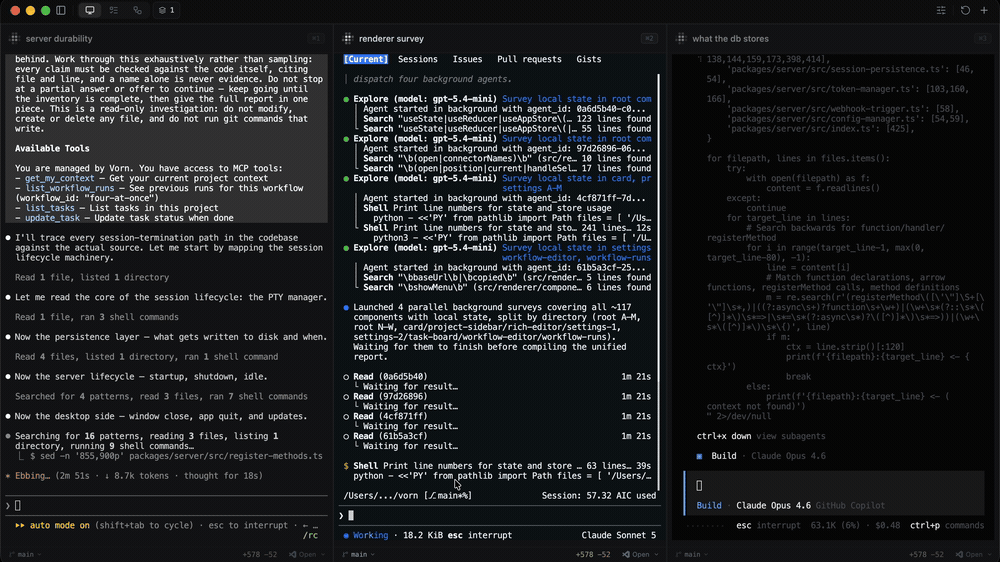
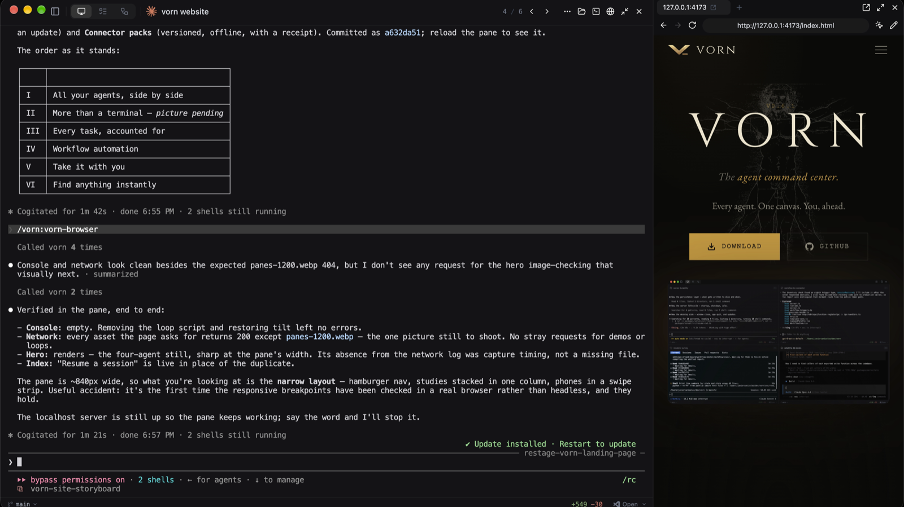
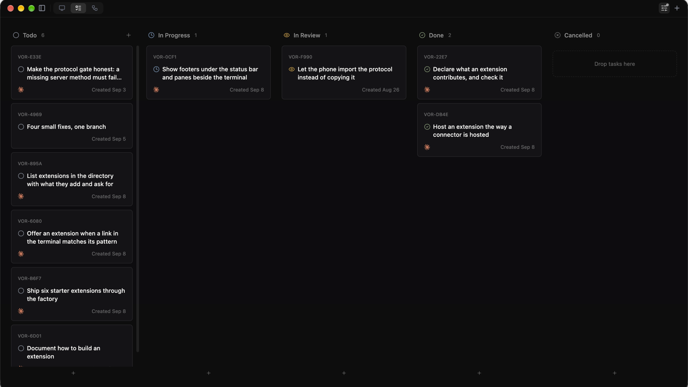
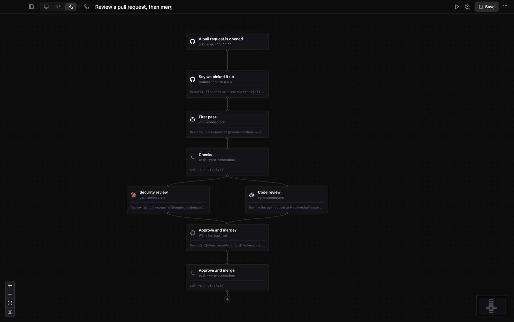
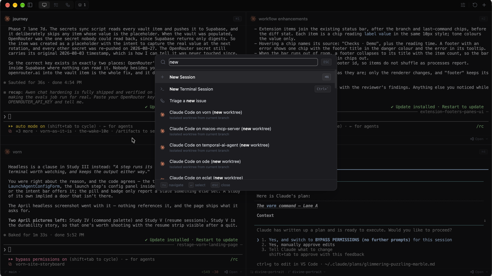

<p align="center">
  
</p>

<p align="center">
  <strong>The agent command center</strong>
</p>

<p align="center">
  Run agents interactively or let them work autonomously — everything local, everything yours.
</p>

<p align="center">
  <a href="https://github.com/vorn-run/vorn/releases"></a>
  <a href="https://github.com/vorn-run/vorn/blob/main/LICENSE"></a>
  <a href="https://github.com/vorn-run/vorn/stargazers"></a>
  
  
</p>

<p align="center">
  <a href="#install">Install</a> &middot;
  <a href="#features">Features</a> &middot;
  <a href="#supported-agents">Agents</a> &middot;
  <a href="#development">Development</a>
</p>

---

<p align="center">
  
</p>

## Why Vorn?

Vorn is the agent command center. How you work is up to you.

**Like vibecoding interactively?** Open multiple terminals and pair with several agents at once — Claude on one task, Copilot on another, Codex on a third. Every agent runs in its own PTY with full native output. No wrappers, no API keys, no reimplementation.

**Prefer to stay hands-off?** Define your tasks and workflows, then let agents work headlessly in the background. Set up a workflow that automatically reviews code when a task moves to "in review", spins up another agent to generate documentation, runs your test suite after every implementation.

**Chain agents together.** A workflow can launch an agent to implement a feature, then trigger a second agent to review the diff, then run a script to deploy, all on a schedule or triggered by task status changes. Everything happens on your machine, orchestrated by you.

**MCP-powered.** Agents can read and write tasks, trigger workflows, and query project state through the built-in MCP server, no extra configuration needed.

> **Early stages.** Vorn is in alpha. The focus right now is stabilizing the core and expanding from there. On the roadmap: SSH remote sessions, shared workspaces for team collaboration, connectors to pull tasks from GitHub Issues, Linear, Jira and more, and a companion web/mobile app so you can monitor your workflows and connect remotely while away from your computer.

## Install

**macOS / Linux:**

```bash
curl -fsSL https://raw.githubusercontent.com/vorn-run/vorn/main/install.sh | sh
```

**Windows (PowerShell):**

```powershell
irm https://raw.githubusercontent.com/vorn-run/vorn/main/install.ps1 | iex
```

**Homebrew (macOS):**

```bash
brew tap vorn-run/tap && brew install --cask vorn
```

Or download directly from [GitHub Releases](https://github.com/vorn-run/vorn/releases).

Each release ships Vorn, the desktop app built on Vorn's GPU UI:

| Platform | Download                                                                               |
| -------- | -------------------------------------------------------------------------------------- |
| macOS    | `Vorn-<version>-arm64.dmg` or `-x64.dmg` (signed and notarized)                        |
| Windows  | `Vorn-Setup-<version>.exe`, a per-user installer                                       |
| Linux    | `Vorn-<version>.AppImage` or `vorn_<version>_amd64.deb`; needs WebKitGTK 4.1 and GTK 3 |

On Linux ARM64 boards, `install.sh` installs the server alone from
`vorn-server-<version>-linux-arm64.tar.gz`: vornd, its session holder and the `vorn` command in
`~/.local/lib/vorn`, run by the systemd user unit `vornd`. Connect to it from another device. Its
options, such as `--host 0.0.0.0`, go in `~/.config/vorn/server.env`; `VORN_NO_SERVICE=1` installs
without starting it.

The app updates itself from the release feed for the channel chosen in Settings (stable or
beta): it downloads in the background, checks the checksum and signature, and swaps itself in
when you restart. Terminals survive the restart on macOS and Linux. The .deb does not update
itself; Vorn says when a new one is out. Windows builds are signed only when the release has a
code-signing certificate, so SmartScreen may ask before the first run.

## Command line

Installing Vorn also puts a `vorn` command on your PATH. It talks to the same server the app
does, and starts one if none is running. The Windows installer adds its folder to your user
PATH, and the .deb installs `/usr/bin/vorn`. On macOS and from the AppImage, the app links it
on first launch, into `/usr/local/bin` when you can write there and `~/.local/bin` otherwise,
and says where. If that folder is not on your PATH, the notice offers the fix.

```bash
vorn session start --agent claude --prompt "fix the failing test"
vorn session list
vorn session read <target>
vorn session send <target> "run the tests"
vorn session wait <target> --timeout 10m
vorn events --json
vorn layout open dev
vorn workflow list
vorn workflow run "Nightly review" --input pr=42
vorn workflow stop <run>
vorn workflow check .vorn/workflows/*.toml
vorn server serve          # a server on its own, without the app
```

`vorn` on its own opens the app. `--json` gives machine-readable output on stdout, with
notices and errors on stderr, so a command can be piped. Settings → General → Command-Line
Tool shows where the command is, and installs or removes it.

### Targets and exit codes

Every command that takes a session reads its `<target>` the same way, and the first rule that
matches decides:

1. a whole session id;
2. a label (the session's name), exactly, then ignoring case;
3. a position: `3` is the third session in `vorn session list`;
4. the start or the end of an id.

A rule that matches several sessions is ambiguous. The command lists the candidates on stderr
(with `--json`, on stdout as `{"error":"ambiguous","candidates":[...]}`) and exits 3. A command
that creates something prints its new id, and `--json` returns it.

| Code | Meaning                                          |
| ---- | ------------------------------------------------ |
| 0    | Done                                             |
| 1    | Failed                                           |
| 2    | The command line was wrong                       |
| 3    | A target matched more than one session or layout |
| 4    | No server could be reached or started            |
| 124  | `session wait --timeout` passed first            |

### Waiting, reading and events

`vorn session wait <target>` blocks until the session's program exits and exits with its code;
`--json` prints the exit record. `--timeout 30s` (also `5m`, `1500ms`; a bare number is seconds)
gives up with 124. `--status idle|done|blocked` waits for the program's status instead, as the
app shows it (the program's own report, then hooks, then the screen rules). It waits on the
server's events and never polls.

`vorn session read <target>` prints the output the server kept. `--lines N` keeps the last N
lines. `--scrollback`, `--unwrap` and `--format vt|html` read the terminal itself, with its
soft-wrapped rows joined: `vt` keeps colours as SGR escapes and `html` draws them as spans in a
`<pre>`. `--trim` drops trailing spaces and trailing blank lines.

`vorn events --json` streams the server's public events, one JSON object per line, until
stopped: `{"v":1,"event":"session.exited","at":1760000000000,"session":"…","data":{…}}`. The
events are `session.created`, `session.status`, `session.exited`, `session.mark`,
`session.program`, `agent.hook`, `git.changed`, `task.created` and `task.statusChanged`. `at` is
milliseconds since the epoch and `session` is present for events about one. `--filter a,b` keeps
those events; `--session <target>` keeps one session's. A client that falls behind is coalesced
the way an extension is: only the latest `session.status` and `git.changed` of a batch.

### Layouts

A layout is a TOML file in `~/.vorn/layouts/` (the server's data directory), or one an
extension offers with `[[contributes.layouts]]` and `file = "layouts/dev.toml"`. It is a tree:
a split (`split = "horizontal"|"vertical"`, `ratio`, `[[children]]`) or one thing to open: a
session (`agent = "claude"`, `command = ["tail", "-f", "app.log"]` or `shell = true`, with
`cwd` and `label`) or `pane = "browser"` with a `url`. Beside `name` and `project`, `view` is
how the grid shows them: `"flexible"` (cards laid out as the tree, each split's direction and
ratio as written), `"grid"` (rows of `columns`, 1 to 4, automatic without it) or `"tabs"`.
Without `view`, a tree with splits opens flexible.

```toml
name = "dev"
project = "vorn"
view = "flexible"
split = "horizontal"
ratio = 0.6

[[children]]
agent = "claude"
label = "agent"

[[children]]
command = ["tail", "-f", "app.log"]
cwd = "logs"
```

`vorn layout list` shows them, `vorn layout open <name> [--project X]` starts the sessions through
the same calls the app makes and prints their ids (3 when the name is ambiguous), `vorn layout save
<name>` writes the project's open sessions in the view the grid shows them (the flexible grid's
splits and ratios included), and `vorn layout check <file>` reports every mistake as `file:line:
message`. The app lists layouts under Open Layout › in the command palette. Sessions start in tree
order. In the app, Columns › Flexible in the view menu splits the grid into panes: drag a divider
to resize (double-click evens them), ⌘⌥ arrows move between panes and ⌘⌥⇧ arrows move the divider.
A `command` runs in a shell, which stays open when it ends; a `pane` opens beside the session
before it and needs the app to be open.

Workflows run in the server, so a run started here keeps going with nothing open — and a
scheduled one happens whether or not the app is running.

## Features

Vorn supports two ways of working. **Interactive**: open a grid of terminals and pair with agents hands-on. **Autonomous**: define tasks and workflows, and let agents run headlessly while you focus on something else. Mix both freely — they share the same projects, tasks, and git integration.

### Multi-Agent Grid

Run Claude, Copilot, Codex, OpenCode, and Gemini in a responsive grid layout. Resize, reorder, minimize, and filter by status. Focus any terminal fullscreen with one click, or switch to a tab view for sequential browsing. Real-time status detection shows whether each agent is running, waiting, idle, or in an error state.

### Panes Beside the Terminal

A session holds its own terminals, a browser, an editor and, with the Device extension from the catalog, an iOS simulator. Draw on the page and the agent sees it; it reads and drives all of them to check its own work.

<p align="center">
  
</p>

### Artifacts

An agent can publish a page, a doc or a design into its session's browser pane. Select the words you mean and comment on them, edit a doc yourself, and send everything back to the agent as one message. Each publish is a new version, and your earlier comments stay pinned to their words. Workflow review gates use the same viewer, so the steps a gate sends back read your comments one by one. See [docs/artifacts.md](docs/artifacts.md).

### Task Queue & Kanban Board

Manage tasks per project with a list view or a drag-and-drop kanban board. Tasks support markdown descriptions, image attachments, git branch targeting, and worktree isolation. Start a task and it launches an agent with the description as the prompt. Tasks can also trigger workflows automatically when created or when their status changes.

<p align="center">
  
</p>

### Workflow Automation

Create multi-step workflows with a visual node editor. Chain together agent launches, script executions (Bash, Python, Node.js, PowerShell), and task queue operations. Schedule them manually, once at a specific time, or on a recurring cron. Workflows can also trigger automatically when tasks are created or change status. A workflow can live as a file in its project's `.vorn/workflows/` folder, and extensions can add step types and triggers. See [docs/workflows.md](docs/workflows.md).

<p align="center">
  
</p>

### Headless Execution

Run agents and scripts in the background without a visible terminal. Headless sessions capture full output logs for later review. Combine with workflow stagger delays to orchestrate multiple agents sequentially, each one picks up where the last left off.

### Inline Diff Review & Git Integration

View git changes in a side panel with file-level stats. Click on any changed line to add a review comment, then send all comments to the agent as structured feedback with one click. Stage, commit, and push directly from the terminal session. Full worktree support for safe parallel work on different branches.

### Command Palette

Fuzzy search for actions, terminals, recent sessions, projects, and workflows. Quick-launch agents, run workflows, and navigate the app without leaving the keyboard.

<p align="center">
  
</p>

### Session Persistence

Restore previous agent sessions on restart. Vorn tracks session history and matches agent sessions for accurate resumption, so you can pick up right where you left off.

### MCP Server

Agents running inside Vorn can access tasks, projects, workflows, sessions, and git state through the built-in MCP server. Create and update tasks, trigger workflows, launch new agents, and query configuration — all from within an agent session.

### More

- **Claude Code Hooks** — real-time agent status, permission request handling, and agent question responses

### Floating Widget

A minimal always-on-top overlay that stays visible while you work in other apps. See agent status at a glance, answer permission requests and agent questions (including the rules an agent offers to keep), jump back into any session with one click, or fold it to a single line of counts. It is an extension: install the Widget from the catalog in Settings › Extensions; Cmd+Alt+W shows or hides it.

<p align="center">
  
</p>

### More

- **Web Client** — the same app in a browser or on your phone, compiled to WebAssembly and served by vornd (`vornd --web`); pair a phone or another computer with a code from the desktop app
- **Extensions** — add sidebar sections, card badges and footers, panes, windows, palette commands, settings pages and more, drawn on the desktop, in the browser and in the terminal alike; see [`examples/extensions/turns`](examples/extensions/turns). An extension runs as a program in any language, or as a sandboxed Wasm component written in Rust with `vorn-extension-sdk` (`vorn ext new --wasm`); see [docs/extensions.md](docs/extensions.md) and [docs/wasm-extensions.md](docs/wasm-extensions.md). A theme is an extension too: colours for the interface and the terminal, as data; see [docs/themes.md](docs/themes.md)
- **Remote Hosts** — launch terminals on remote machines via SSH
- **Terminal Panel** — lightweight shell tabs for quick operations
- **Project Management** — organize sessions by project with custom icons, colors, and preferred agents
- **Auto-Update** — built-in update checking and installation
- **Cross-Platform** — macOS, Windows, and Linux

## Supported Agents

| Agent          | Command      |
| -------------- | ------------ |
| Claude Code    | `claude`     |
| GitHub Copilot | `gh copilot` |
| OpenAI Codex   | `codex`      |
| OpenCode       | `opencode`   |
| Google Gemini  | `gemini`     |

Any CLI tool that runs in a terminal works with Vorn. These are the agents with built-in status detection and icons.

## Development

**Prerequisites:** a Rust toolchain and [Zig 0.16.0](https://ziglang.org/download/) for the native core; Node.js 22 and Yarn for the MCP server, the connector SDK and the tests; `brotli` for the web client

```bash
# Install dependencies
yarn install

# Build vornd, the server, with its session holder and the vorn command
yarn build:core

# Run the desktop app
cd packages/core && cargo run --release -p vorn-app

# Build the web client (the app compiled to WebAssembly) into packages/core/crates/vorn-web/dist
yarn build:web

# Check it in headless Chromium against a test vornd
cd packages/core && node crates/vorn-web/tests/smoke.mjs
```

## Contributing

Vorn takes contributions as issues. See [CONTRIBUTING.md](CONTRIBUTING.md).

## License

[MIT](LICENSE) - Javier Canizalez
